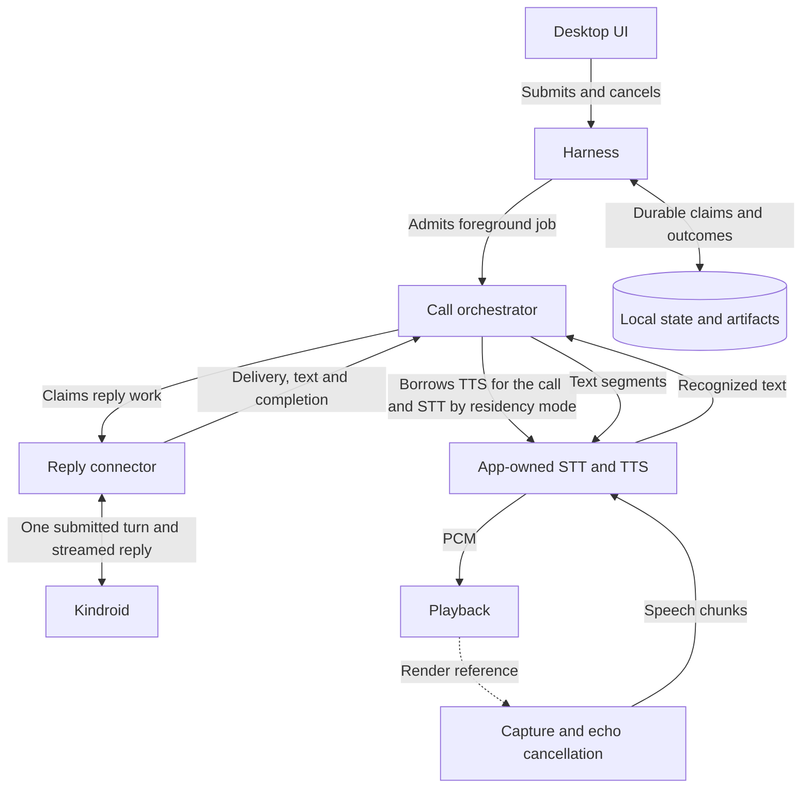
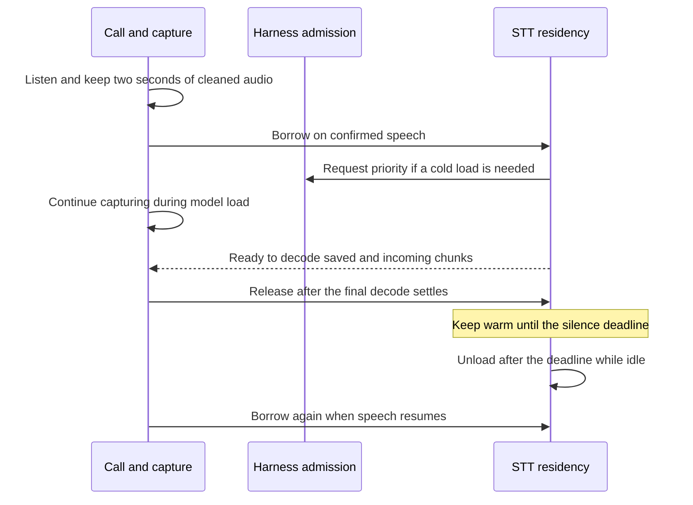
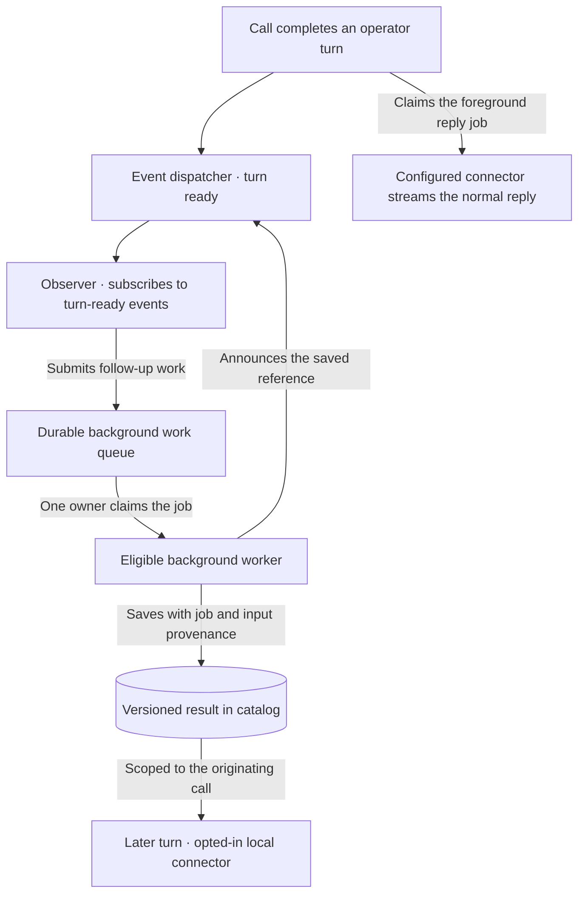
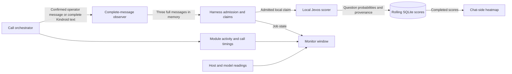

# Architecture diagrams

## Voice workflow

The harness admits and tracks work. The call owns turn order. Speech and audio
workers handle their own inputs and outputs. The reply connector reports
delivery, streamed text, and a terminal outcome.

## Recognition after a long pause

In dynamic mode the microphone opens independently of STT. A call acquires the
selected Pocket voice when unmuted and borrows recognition for spoken turns.
Warm mode borrows STT before opening the microphone and releases it after the
call with no silence deadline.

Loading, readiness, reuse, failure, and unloading produce lifecycle events.
Those notifications describe completed transitions. The model owners handle
the explicit acquire and release operations.

## Work that finishes later

The headless fixture exercises a background capability with a local connector.
The connector can use the saved result on a later turn in the same call.

## Desktop scoring and monitoring

See the [voice runtime](../architecture.md) for current adapters and the
[harness design](README.md) for the intended extension points.
